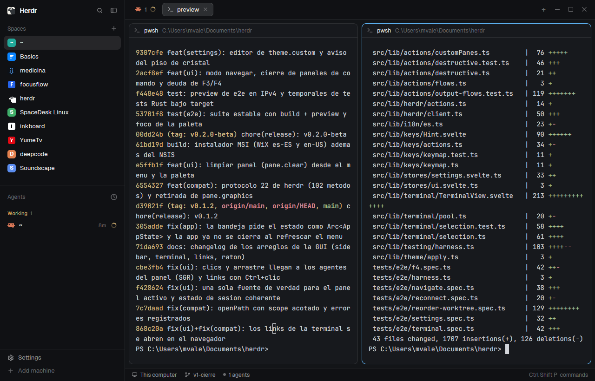

# One Dark

Herdr's own window (spaces and agents on the left, tabs as pills, panes as cards, a status bar) in the One Dark palette as **herdr-desk** paints it, with a sky-blue `#60b9fc` accent. Flat, solid panels. One Dark in dark mode, One Light in light mode; it follows the system appearance by itself.



## What's inside

| File | What it is |
|---|---|
| `layouts/onedark.json` | the layout (Herdr's main window structure) |
| `layouts/onedark.png` | the picture Settings shows for it |
| `mods/spaces-icons/` | the Spaces list, showing each project's own icon on its avatar |
| `themes/herdr-onedark.json` | One Dark |
| `themes/herdr-onelight.json` | One Light |

**Project icons:** the Spaces list (`mods/spaces-icons`, a clone of Herdr's `spaces`) shows each project's own icon on its avatar when the project has one: a Tauri app icon, `icon.*`, `logo.*`, `assets/`, `public/` logos, or a favicon, in the project folder, one folder down, or in `apps/*` / `packages/*`. Drop an `.herdr/icon.png` (or `.svg`) in a project to choose its icon. Projects without one keep the colored letter.

What it touches: it reads your spaces' project folders, copies the icon it finds into `~/.config/herdr-app/data/spaces-icons/` (PNGs with `cmd /c copy` on Windows, `cp` elsewhere) and remembers the results in shared state. No network access. The other mods are Herdr's own.

## Install

Copy the folders into your Herdr home (`~/.config/herdr-app`, or `HERDR_APP_HOME`), then switch to the layout:

```sh
git clone https://github.com/MarcozVD/herdr-layout-onedark
cp -r herdr-layout-onedark/{layouts,themes,mods} ~/.config/herdr-app/
herdr-app do layout.switch '{"name":"onedark"}'
```

On Windows PowerShell:

```powershell
git clone https://github.com/MarcozVD/herdr-layout-onedark
Copy-Item -Recurse -Force herdr-layout-onedark/layouts,herdr-layout-onedark/themes,herdr-layout-onedark/mods "$HOME/.config/herdr-app/"
herdr-app do layout.switch '{"name":"onedark"}'
```

`ctrl-shift-l` cycles back to your other layouts. To remove it, delete the files listed above (and `data/spaces-icons/`) from `~/.config/herdr-app`.

Or ask your agent to add it: *"add the Herdr layout at github.com/MarcozVD/herdr-layout-onedark"*.

## Build it yourself

[`RECIPE.md`](RECIPE.md) is the full brief (regions, sizes, exact colors, node tree, gotchas, checks): an agent with an empty folder can rebuild the layout from it.

The themes also work on their own: set `"theme": { "light": "herdr-onelight", "dark": "herdr-onedark" }` in `settings.json` to use them with any layout.

Palette: Atom's One Dark / One Light (MIT).

## Related

- [herdr-layout-catppuccin](https://github.com/MarcozVD/herdr-layout-catppuccin): Catppuccin Mocha / Latte, solid panels.
- [herdr-layout-onedark](https://github.com/MarcozVD/herdr-layout-onedark): One Dark / One Light, solid panels.
- [herdr-layout-glass](https://github.com/MarcozVD/herdr-layout-glass): glassmorphism in neutral graphite.
