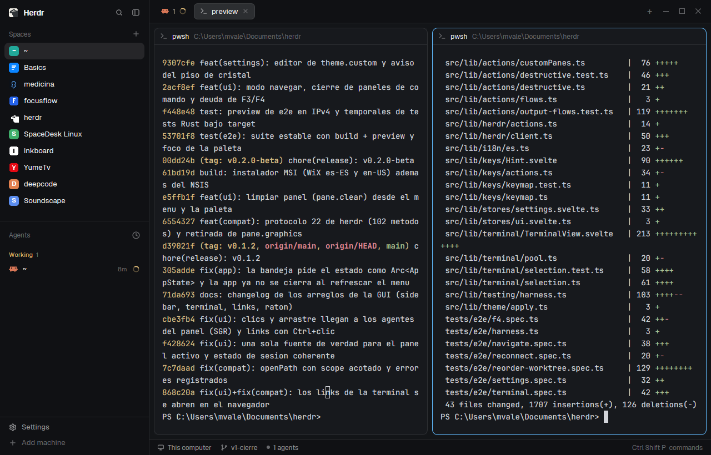

# One Dark

Herdr's own window (spaces and agents on the left, tabs as pills, panes as
cards, a status bar) in the One Dark palette, as herdr-desk paints it, with a
sky-blue `#60b9fc` accent. Flat, solid panels, no transparency. It follows the
system's appearance: One Dark when dark, One Light when light.

## What you see

Left to right, at zoom 1. Dark values first, light in parentheses.

- **Sidebar**, 268px wide (44–480), on `chrome` `#21252b` (`#f0f0f1`), no
  system title bar:
  - top 46px: Herdr brand row with search and fold buttons (drags the window);
  - Spaces and Agents lists sharing the height equally (each at least 90px);
  - bottom 69px: Settings and Add machine.
- 1px divider in `border` `#181a1f` (`#dbdbdc`).
- **Work column** on `canvas` `#1e2227` (`#eaeaeb`):
  - top 42px: tabs as pills, `+` menu and window buttons (drags the window);
  - the active tab's panes as cards: 8px padding and gaps, radius 10, on
    `background` `#282c34` (`#fafafa`), 1px `border`; the focused pane gets a
    1px `#60b9fc` border; a 30px header on top of each (program icon, title,
    folder);
  - Files/Changes panel on the right, 368px (280–900), hidden at start;
  - bottom 28px: status bar (machine, branch, agent count, palette hint).
- Terminals: text `#abb2bf` on `#282c34` (`#383a42` on `#fafafa`), cursor
  `#60b9fc`, selection `#3e4451` (`#e5e5e6`), padding 14px × 12px. Fonts:
  Herdr's defaults, JetBrains Mono 14 and Geist.
- Other colors: `surface` `#2c313a` (`#f5f5f6`), `popover` `#2c313a`
  (`#ffffff`), `raised` `#3e4451` (`#ffffff`), `hover` `#abb2bf14`
  (`#383a4214`), `selected` `#60b9fc38`, `input` `#3e4451` (`#c8c8ca`),
  `muted` `#969ca8` (`#686b77`), `dim` `#737a87` (`#686b77`); buttons
  `#60b9fc` with `#14151c` text.
- **Project icons on the space avatars**: in the Spaces list, each space whose
  project has an icon shows it on its 18px avatar (radius 5), in full color.
  Spaces without one keep Herdr's colored letter tile.

## How it behaves

- Agent status in the shipped mods (agents list, tab pills, status bar):
  **working** `#61afef` (`#4078f2`), **blocked** `#e5c07b` (`#c18401`),
  **done** `#98c379` (`#50a14f`), **idle** `#5c6370` (`#a0a1a7`), unknown
  `#c678dd` (`#a626a4`).
- Everything else is Herdr (main): click a space or tab to show it, `+` starts a
  terminal or an agent, the tab bar opens Files/Changes, `ctrl-shift-b` folds the
  sidebar to a 44px rail, `ctrl-shift-l` cycles layouts, panes drag by the
  top-center grip.
- **Project icons**: for each space on this computer, the `spaces-icons` mod
  looks in its project folder (the git repo's top, else where its first terminal
  is, else where the space was made; never the home folder) for, in this order:
  `.herdr/icon.svg|png` (an override), Tauri icons
  (`src-tauri/icons/128x128@2x.png`, `128x128.png`, `icon.png`), `icon.*`,
  `logo.*`, `assets/`, `build/`, `resources/`, `src/app/`, `public/`,
  `src/assets/`, `.github/`, `docs/` logos and icons, then favicons
  (`public/favicon.svg`, ...). Each candidate is tried in the folder itself, its
  subfolders and `apps/*` / `packages/*`, so monorepos work. The first hit
  wins; PNGs under 16px wide are skipped as placeholders. Icons appear a few
  seconds after start the first time, then at once (remembered in shared
  state), and a project gets looked at again on the next start.

## Built from

- `layouts/onedark.json`: the shipped `main` tree with root
  `"theme": { "light": "herdr-onelight", "dark": "herdr-onedark" }` and
  `"preview": "layouts/onedark.png"`. Root: `row`, `titlebar: "none"`,
  `traffic_lights: [12, 16]`, `background: "canvas"`, `terminal_padding: [14, 12]`,
  divider 1px `border`.
  - `sidebar` (column, 268px, min 44, max 480, `chrome`, `resizable: false`):
    `brand` (46px, `window_drag`, mod `workspace-chrome`), `sidebar-lists`
    column with `spaces` (mod `spaces-icons`) and `agents` (weight 1, min 90), `sidebar-footer`
    (69px, mod `workspace-chrome`, props `{ "footer": true }`).
  - `work` (column, `resizable: false`): `tabs` (42px, `window_drag`, mod
    `tabs`); `work-body` row (padding 8, gap 8) with `main`
    (`{ "tab": "active" }`, pane frame gap 8, radius 10, background
    `background`, `lone: true`, border 1 `border`, focus 1 `accent`, header mod
    `pane` 30px top `reveal: "always"`) and hidden `panel` column (368px) with a
    `stack` of `files` and `changes`; `status` (28px, mod `workspace-status`).
- Mods: `spaces-icons` (below) for the Spaces list, and the shipped
  `workspace-chrome`, `agents`, `tabs`, `pane`, `files`, `changes`,
  `workspace-status`.
- `themes/herdr-onedark.json` and `themes/herdr-onelight.json`, from herdr's
  `one-dark` / `one-light` tokens as herdr-desk uses them:
  - `background` = `panel_bg`, `foreground` = `text`, `selection` =
    `surface1`, `cursor` = accent `#60b9fc`.
  - `ansi` (dark): `#282c34 #e06c75 #98c379 #e5c07b #61afef #c678dd #56b6c2 #abb2bf
    #5c6370 #d37e88 #9dbf8b #d7bd8c #74b0e3 #bf87d6 #6bb5c1 #abb2bf`; light:
    `#f5f5f6 #e45649 #50a14f #c18401 #4078f2 #a626a4 #0184bc #383a42
    #a0a1a7 #b94f47 #4a874c #9f7211 #3e69c6 #8b2b8c #0f729e #383a42`.
    Black = `surface_dim`, bright black = `overlay0`, other brights = the
    color mixed 25% toward `text`.
  - `colors`: the panel colors listed above, all opaque except `hover` and
    `selected`.
- `mods/spaces-icons/`: a clone of the shipped `spaces` mod
  (`herdr-app do mod.clone '{"name":"spaces","as":"spaces-icons"}'`), used by the
  `spaces` block instead of `spaces`. Its changes:
  - `icons.js`: `findIcon(root)` lists the folders once (`fs.readdir`), skips
    candidates whose first path part isn't there, checks the rest with
    `fs.exists`, reads a PNG's width from its header, and copies the hit into
    `data/spaces-icons/<hash of path>.<svg|png>` in the Herdr home, because
    `image()` only reads paths relative to the home. SVGs are copied as text
    (`fs.readFile` utf8 + `fs.writeFile`); PNGs with `exec("cmd", ["/c",
    "copy", "/y", src, dest])` on Windows, `exec("cp", [src, dest])` elsewhere.
  - `main.js`: `roots(space, panes)` gives the project folders,
    `lookForIcons` runs in the 250ms `checkNew` tick and searches each folder
    once per run, results go to `this.icons` and `setShared("spaces-icons.found",
    {folder: path|null})`; `init` starts from that shared map. `grouped` reads
    `panes()` once per render and passes each row its `icon`; `row` draws
    `div().size(18).rounded(5).overflow_hidden().child(image(icon).size(18))`,
    else the original letter tile. Everything else is the shipped `spaces`.

## Watch out

- `spaces-icons` reads files outside its own folder (the projects of your
  spaces) and runs a program to copy PNG icons (`cmd /c copy` on Windows,
  `cp` elsewhere). It writes only under `data/spaces-icons/` and the shared key
  `spaces-icons.found`. No network.
- `image("C:/abs/path.png")` draws nothing: icons must be copied into the home.
  `fs.writeFile` with the `Uint8Array` from `fs.readFile` wrote 0-byte files
  in this build, hence the system copy for PNGs.
- Reading `panes()` inside each row made the list too slow to render ("This view
  could not be re-rendered"); read it once per render.
- Spaces on other machines and the `~` space keep the letter tile. `.ico`
  favicons aren't used (GPUI doesn't draw them). A changed icon file shows after
  the next start; delete `data/spaces-icons/` and the shared key to forget all.
- The rail (sidebar narrower than 160px) shows numbers, as the shipped mod does,
  not icons.

- Theme files are not named like the layout (`themes/onedark.json` would be the
  layout's own and offer only one appearance); two names give dark and light.
- The accent is the person's `[theme.custom] accent` `#60b9fc`, not One Dark's
  `#61afef`.
- In dark, ANSI black `#282c34` equals the terminal background, as in
  herdr-desk (One Dark's `surface_dim` is its panel color): text a program
  prints in black is invisible.
- A theme pick in Settings > Look is saved per layout in `layouts/.state/` and
  beats the file; reset with `herdr-app do app.theme '{"name":"herdr-onedark"}'`.
- `herdr-app shot` returns the last rendered frame; let the window redraw
  after a change.

## Done when

- `herdr-app do layout.switch '{"name":"onedark"}'` shows it and
  `herdr-app status` lists no errors.
- In dark appearance, a screenshot reads `#21252b` on the sidebar and tab bar
  and `#282c34` in an empty terminal; the focused pane's border is `#60b9fc`.
- `themes()` from a mod lists `herdr-onedark` (`light: false`) and
  `herdr-onelight` (`light: true`).
- `herdr-app check mods/spaces-icons` passes.
- A space whose repo has `src-tauri/icons/128x128.png` shows that picture on its
  avatar within about 10 seconds, and `data/spaces-icons/` holds a non-empty copy;
  a space with no icon file shows its colored letter.
